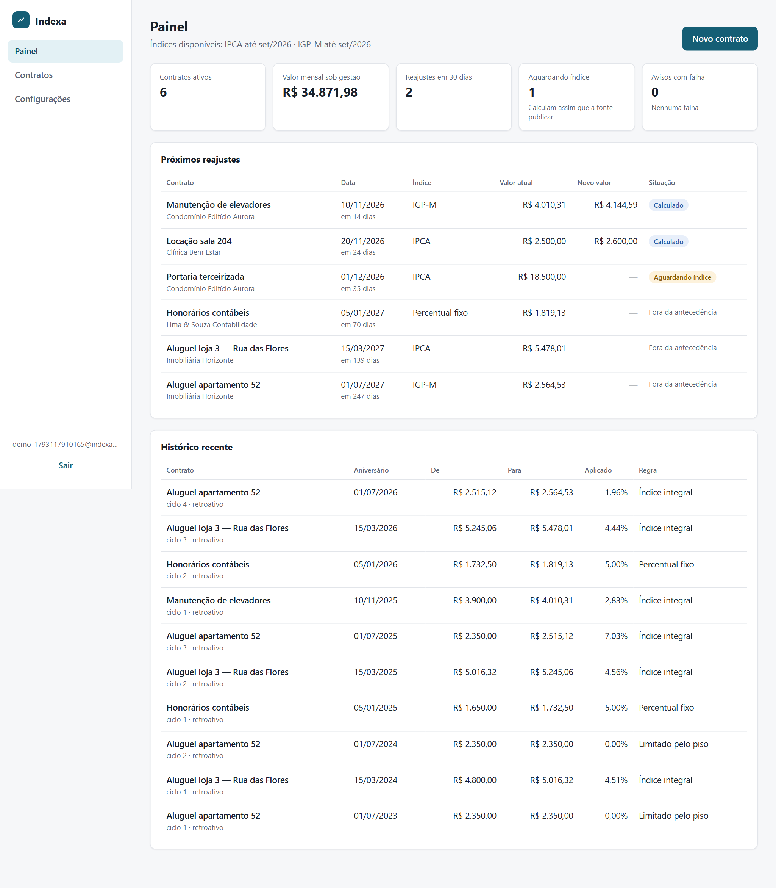
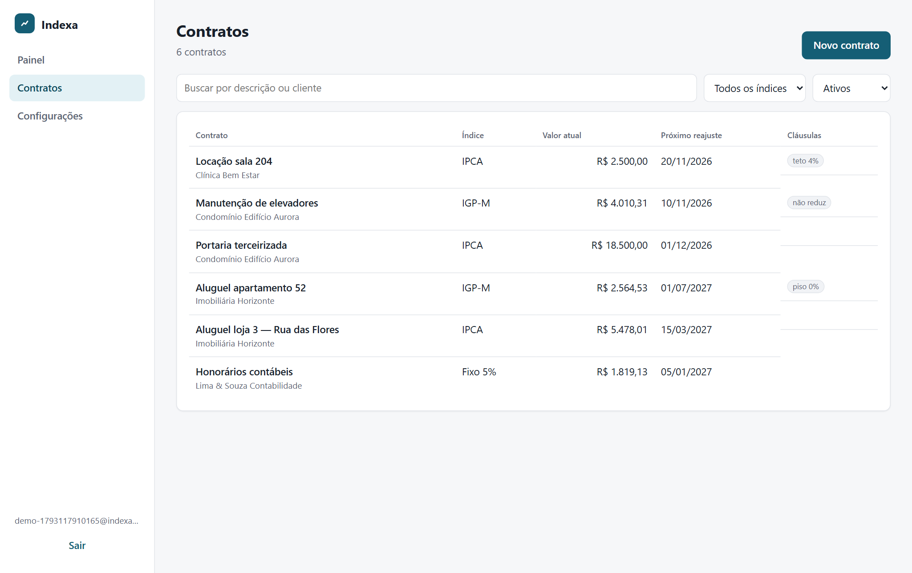
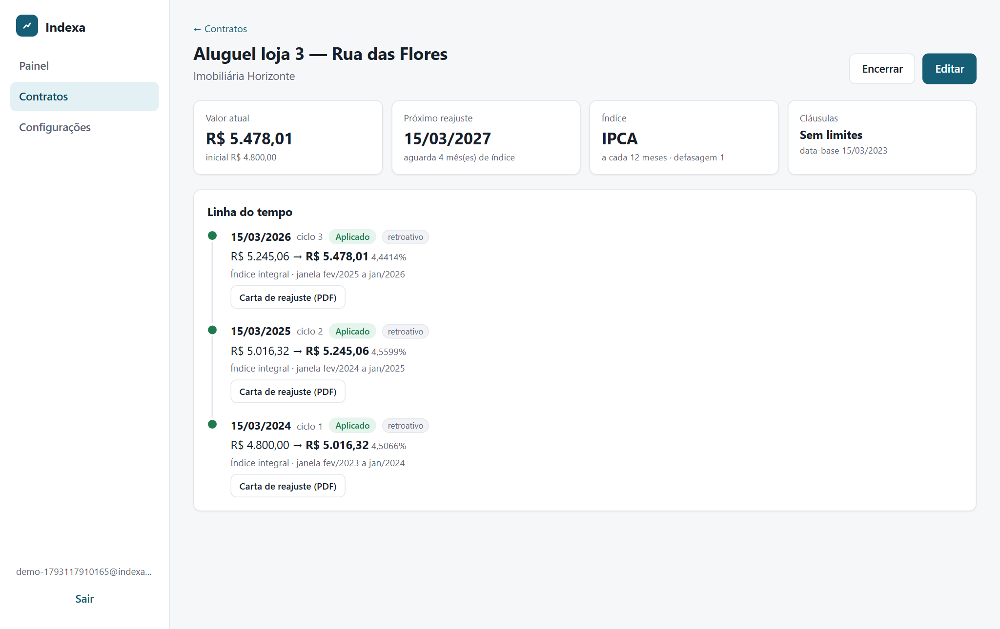
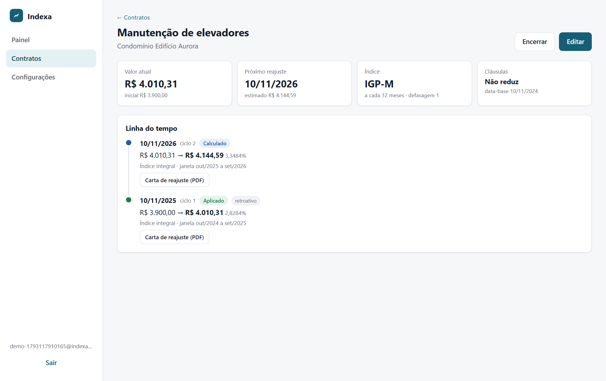
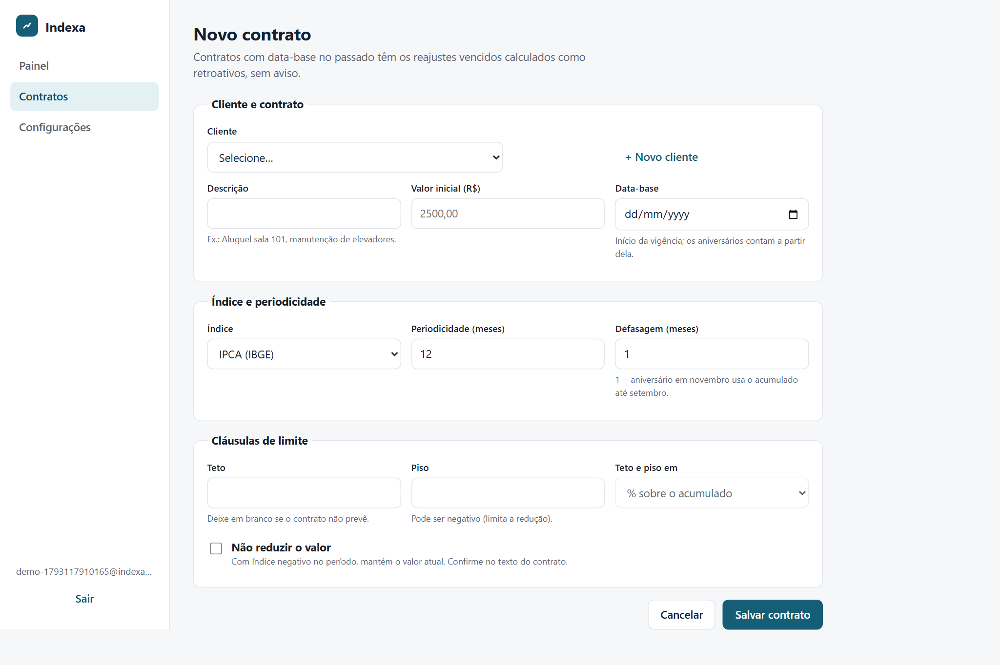
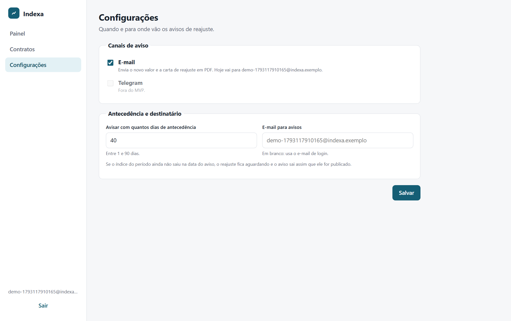
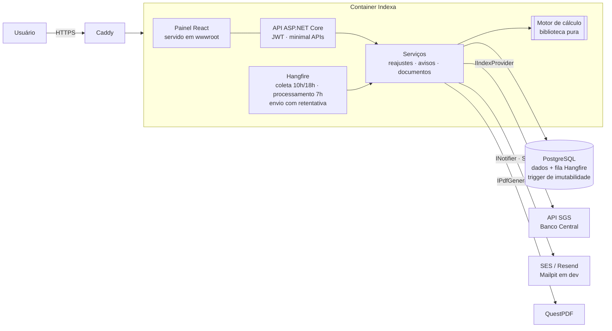
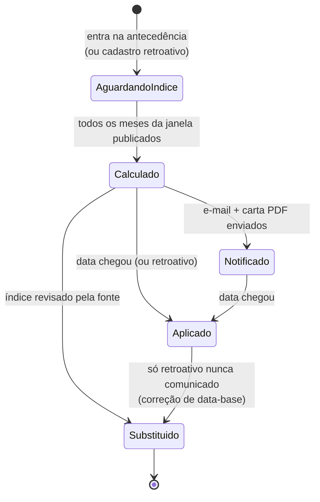

# Indexa

Sistema web que controla contratos recorrentes e calcula o reajuste anual **na data certa, com o índice oficial**: IPCA, IGP-M ou percentual fixo, respeitando teto, piso e cláusula de não redução. Avisa o responsável antes do aniversário com a carta de reajuste em PDF e guarda um histórico imutável para auditoria.

[](https://github.com/Adriano2712/indexa/actions/workflows/ci.yml)
[](https://github.com/Adriano2712/indexa/actions/workflows/imagem.yml)

**Stack:** .NET 10 (ASP.NET Core, EF Core) · PostgreSQL · Hangfire · QuestPDF · React 19 + TypeScript · Docker · GitHub Actions

> **Deploy:** ainda não publicado. Os arquivos de produção estão em [`deploy/`](deploy/) (ver [Deploy](#deploy)).

## O problema

Imobiliárias pequenas, administradoras de condomínio, escritórios de contabilidade e prestadores de serviço controlam reajustes em planilha. Os erros se repetem:

- a data de aniversário passa e ninguém reajusta;
- usa-se o índice errado ou o período errado (IPCA de quais 12 meses?);
- teto, piso e "não reduzir" são aplicados de forma inconsistente;
- não sobra registro de **como** o valor foi calculado.

O Indexa automatiza a coleta do índice, o cálculo, o aviso e o registro.

## Telas

| Painel | Contratos |
|---|---|
|  |  |
| **Linha do tempo (retroativos)** | **IGP-M negativo com "não reduzir"** |
|  |  |
| **Cadastro de contrato** | **Configurações de aviso** |
|  |  |

Os dados das telas são fictícios; os índices são reais (SGS/Banco Central). Gerados por [`web/scripts/capturar-telas.mjs`](web/scripts/capturar-telas.mjs).

## Arquitetura



| Projeto | Responsabilidade |
|---|---|
| `src/Indexa.Dominio` | Entidades, regras e transições (reajuste, contrato, notificação). Sem dependências externas. |
| `src/Indexa.Calculo` | **Motor de reajuste puro**: sem banco, rede ou relógio; recebe "hoje" e os índices por parâmetro. |
| `src/Indexa.Api` | API REST, EF Core/PostgreSQL, Hangfire, SMTP, PDF e o painel compilado. |
| `web/` | Painel React + TypeScript (Vite). |

Interfaces anti lock-in: `IIndexProvider` (fonte dos índices), `INotifier` (canal de aviso), `IPdfGenerator`, `IArmazenamentoDocumentos`.

### Ciclo de vida de um reajuste



Reajuste **notificado ou aplicado não muda**: correção gera uma nova revisão. A regra é garantida na aplicação e por um trigger no Postgres.

## O cálculo

```
acumulado   = Π (1 + variação_mensal / 100) − 1        (sem arredondar)
percentual  = limitar(acumulado, piso, teto)            (teto/piso sobre o percentual, ou em R$ de aumento)
novo valor  = valor_atual × (1 + percentual)
se "não reduzir" e novo valor < valor atual → mantém o valor atual
novo valor  = arredondar(novo valor, 2 casas, meio exato para longe do zero)   ← único arredondamento
```

**Janela:** com defasagem 1 (padrão), um aniversário em fevereiro/2026 usa jan a dez/2025. Os detalhes de cada regra estão nos [ADRs](docs/adr.md).

### Exemplo conferível

Contrato de **R$ 2.500,00**, IPCA, aniversário em 10/02/2026. Variações mensais do IPCA em 2025 (SGS série 433):

| jan | fev | mar | abr | mai | jun | jul | ago | set | out | nov | dez |
|---|---|---|---|---|---|---|---|---|---|---|---|
| 0,16 | 1,31 | 0,56 | 0,43 | 0,26 | 0,24 | 0,26 | −0,11 | 0,48 | 0,09 | 0,18 | 0,33 |

- Acumulado: 1,0016 × 1,0131 × … × 1,0033 − 1 = **4,2644%**, que bate com o IPCA 12 meses oficial de dez/2025 (4,26%, SGS série 13522).
- Novo valor: 2.500,00 × 1,042644 = 2.606,6096… → **R$ 2.606,61**.
- Com **teto de 4%**: **R$ 2.600,00** (regra registrada: "Limitado pelo teto").
- Se o acumulado fosse arredondado antes (4,26%), o resultado seria R$ 2.606,50. É por isso que o motor só arredonda no fim.

Contraexemplo real: IGP-M 2025 acumulou **−1,04%**. Sem cláusula, R$ 2.500,00 cai para R$ 2.473,95. Com "não reduzir", fica em R$ 2.500,00 e o acumulado negativo continua registrado.

## Testes

O motor é o centro da estratégia: **todo número esperado vem de série oficial**, calculado de forma independente (Python `decimal`) e conferível.

| Camada | O que cobre |
|---|---|
| **Motor** (`Indexa.Calculo.Tests`, 172) | Tabela de casos com IPCA/IGP-M reais: teto, piso, piso negativo, não redução, teto em R$, percentual fixo, meio exato no arredondamento, janela/defasagem, 29/02 e fim de mês, retroativos encadeados, mês não publicado. **Oráculo:** 129 janelas de IPCA 12 meses (2016–2026) contra a série oficial 13522. **Propriedades (FsCheck, 500 casos cada):** valor sempre com 2 casas, não redução nunca reduz, teto e piso respeitados, índice maior nunca gera valor menor, determinismo. |
| **Domínio** (`Indexa.Dominio.Tests`, 52) | Validações, transições do reajuste, reserva e esgotamento de tentativas da notificação, preferências. |
| **Integração** (`Indexa.Api.IntegrationTests`, Postgres e Mailpit reais via Testcontainers) | Ciclo de vida completo com relógio controlado: retroativos sem aviso, aviso com PDF e aplicação na data, índice atrasado, **6 processamentos e 5 envios em paralelo sem duplicar**, falha de SMTP até *Falhou*, **trigger recusando UPDATE/DELETE**, revisão de índice pela fonte, correção de data-base, isolamento entre usuários, painel. |

```bash
dotnet test                                            # precisa do Docker
INDEXA_TESTES_EXTERNOS=1 dotnet test --filter Api_real # chama o SGS de verdade
```

O CI (GitHub Actions) roda formatação, build com avisos como erro, verificação de pacotes vulneráveis, os testes e o build do painel.

## Tratamento de falhas

| Situação | Comportamento |
|---|---|
| Índice do mês ainda não publicado | Reajuste fica `AguardandoIndice`; o job diário tenta de novo; o aviso só sai após o cálculo. |
| API do Banco Central fora do ar | Timeout de 20 s por tentativa, 3 retentativas, circuit breaker. O processamento segue com o último dado guardado; o job de coleta termina em *Failed* (visível) e é reexecutado. |
| Fonte revisa um índice já coletado | Divergência registrada. Reajustes ainda não enviados são recalculados (nova revisão); os já emitidos **não mudam** e a divergência fica marcada para revisão humana. |
| Job executado duas vezes ou em paralelo | Unicidade (contrato + ciclo vigente), chave de idempotência e controle de versão (`xmin`) barram a segunda gravação. |
| Falha no envio do e-mail | 5 tentativas (1 min → 1 h). Esgotadas: notificação `Falhou`, job em *Failed* no painel do Hangfire e contador no painel do Indexa. |
| Processo morre no meio do envio | A reserva expira em 15 min e o envio é refeito (garantia de "pelo menos uma vez"); o `Message-ID` fixo permite ao cliente de e-mail descartar a duplicata. |
| Fuso horário | Aniversários, avisos e jobs usam o calendário de Brasília (`America/Sao_Paulo`). |
| Job esgota as tentativas | Filtro global do Hangfire envia e-mail para `ALERTAS_EMAIL` com o job e o erro. |
| Perda do servidor | `pg_dump` diário em `deploy/backups` com retenção configurável (14 dias por padrão). |

## Segurança

- Senhas com PBKDF2 (`PasswordHasher` do ASP.NET Core) e limite de tentativas de login por IP.
- Sessão do painel em **cookie `HttpOnly` + `SameSite=Strict` + `Secure`**: o JavaScript da página nunca vê o token, e requisições vindas de outros sites não levam o cookie. Clientes de API usam `Authorization: Bearer`.
- Cada usuário só enxerga os próprios clientes, contratos e cartas (testado).
- Segredos só por variável de ambiente ou user-secrets; o CI barra pacote com vulnerabilidade conhecida.
- Dados pessoais mínimos (LGPD): nome e, opcionalmente, CPF/CNPJ e e-mail do cliente.

## Como rodar

Pré-requisitos: .NET SDK 10, Node 22+, Docker.

```bash
docker compose up -d                       # Postgres (porta 5433) e Mailpit (caixa de entrada em http://localhost:8026)
dotnet user-secrets set "Jwt:Chave" "$(openssl rand -base64 48)" --project src/Indexa.Api
cd web && npm ci && npm run build && cd ..  # compila o painel para src/Indexa.Api/wwwroot
dotnet run --project src/Indexa.Api        # http://localhost:5080 (painel de jobs em /hangfire)
```

Para desenvolver o painel com recarga automática: `cd web && npm run dev` (http://localhost:5173, com `/api` redirecionado para a API).

Na primeira execução, dispare o job **coleta-indices** em `/hangfire`. Ele baixa o histórico do IPCA e do IGP-M desde 1994.

## Deploy

Uma VM com Docker Compose: um container com API, painel e jobs, mais Postgres, Caddy (HTTPS automático) e backup diário. O motivo e as alternativas estão na [ADR-13](docs/adr.md#adr-13--deploy-uma-vm-com-docker-compose). A cada push na `main` com CI verde, o GitHub Actions publica a imagem `ghcr.io/adriano2712/indexa` para amd64 e arm64.

1. Crie uma VM Ubuntu (x86 ou ARM), libere as portas 80 e 443 no firewall do provedor e aponte um domínio (registro A) para o IP dela.
2. Tenha uma conta SMTP (Amazon SES, Resend ou outra) com o domínio de envio verificado.
3. Na VM:
   ```bash
   git clone https://github.com/Adriano2712/indexa.git && cd indexa
   bash deploy/instalar.sh      # 1ª vez: instala o Docker e cria deploy/.env com senhas geradas
   nano deploy/.env             # DOMINIO, SMTP_*, ALERTAS_EMAIL
   bash deploy/instalar.sh      # sobe tudo
   ```
4. Para os usuários do beta criarem conta, `PERMITIR_REGISTRO=true`, rode o script de novo e volte para `false` depois.

Atualizar: `docker compose -f deploy/compose.prod.yml --env-file deploy/.env pull && docker compose -f deploy/compose.prod.yml --env-file deploy/.env up -d`.

Restaurar um backup:
```bash
docker compose -f deploy/compose.prod.yml --env-file deploy/.env exec -T postgres \
  pg_restore -U indexa -d indexa --clean --if-exists < deploy/backups/indexa-AAAAMMDD-HHMM.dump
```
Os backups ficam na própria VM; para sobreviver à perda dela, copie `deploy/backups` para fora periodicamente (por exemplo, `rclone` para um bucket).

## Decisões e limites do MVP

- Decisões registradas em [`docs/adr.md`](docs/adr.md) (15 ADRs: regras de cálculo, idempotência, imutabilidade, sessão, deploy).
- As regras de cálculo modelam cláusulas comuns; **não são parecer jurídico**. O texto de cada contrato prevalece.
- Fora do MVP: múltiplos usuários por empresa, importação por planilha, assinatura digital do aditivo, cobrança, app mobile, integração com sistemas de imobiliária.
- Próximos passos técnicos: PDFs em object storage para escalar além de um servidor; revogação de sessão no servidor (hoje "sair" apaga o cookie e o token expira em 60 min); painel do Hangfire autenticado em produção (hoje desligado; falhas chegam por e-mail).
